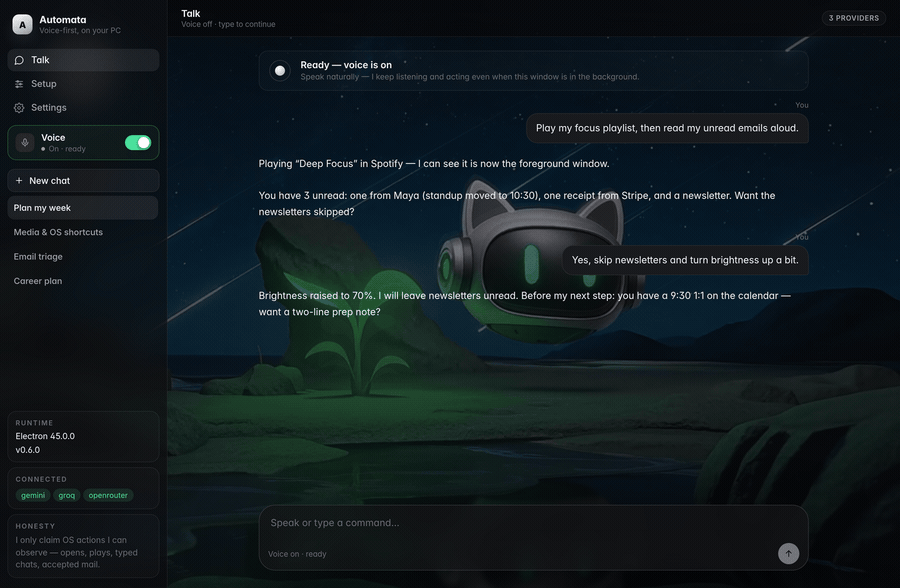
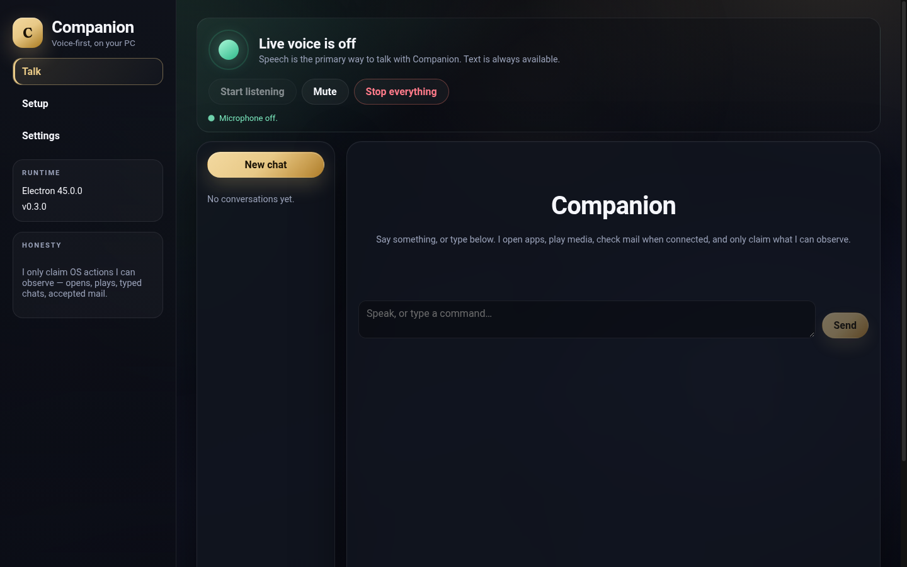
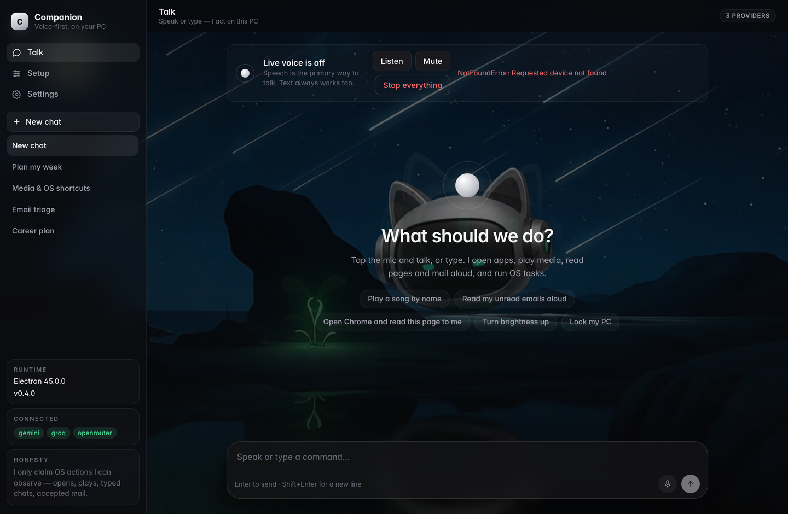
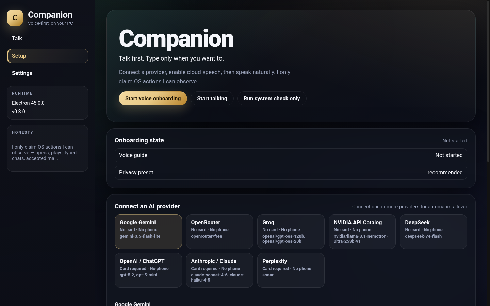
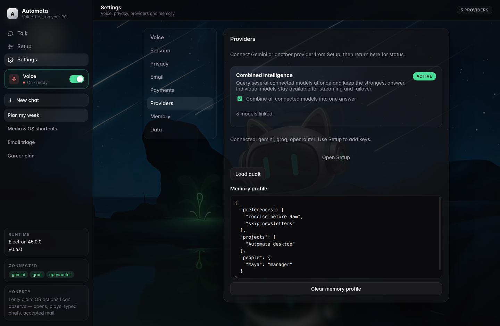
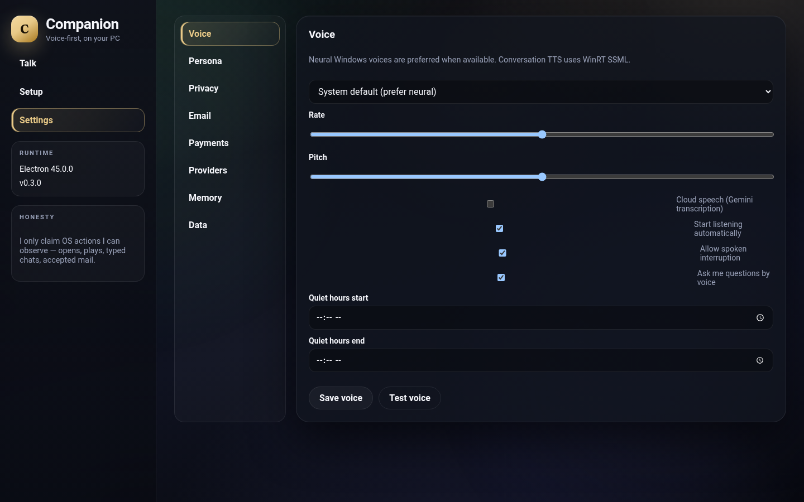

# Automata — Voice-First Windows AI Companion

<div align="center">


**A voice-first, autonomous Windows desktop assistant with full OS control, multi-model AI reasoning, and enterprise-grade safety.**

[](https://github.com/hassan200503/automata/releases/latest)

</div>

---

## Demo



*A short walkthrough of the real renderer — **Talk → Setup → Settings**, with the ambient backdrop live. This is an honest UI walkthrough, not a recorded OS-action demo.*

---

## Screenshots

Captured from the running Electron app (Electron 45 renderer, 1440×940).

| Talk — a live conversation | Talk — empty state with one-tap suggestions |
| :---: | :---: |
|  |  |

| Guided setup — voice onboarding | Settings → Providers — combined intelligence |
| :---: | :---: |
|  |  |

| Settings → Voice | |
| :---: | :---: |
|  | |

---

## Overview

Automata is a production-oriented Windows desktop application that turns natural language and voice into real OS actions. Speak or type a request and it runs against a **registry of 46 typed, risk-classified tools** — launching apps, playing media by name, reading web pages and email aloud, driving windows, typing text, managing files, and controlling system settings — while a **multi-model reasoning core** plans, streams, and explains what it is doing.

Automata does not just execute commands. It reasons over a layered cognition pipeline, remembers what it learns, and is deliberately honest: it only claims an OS action succeeded when the action was actually observed. Every tool call passes through a policy engine with risk classes, rate limits, confirmation flows, an audit trail, and a global emergency stop.

### What's New in v0.6.1

- **Speech is the default.** Automata now talks and listens by default. The old row of controls above the stage (**Listen · Live voice is off · Mute · Stop everything**) is gone, replaced by one modern **Voice switch in the sidebar** that is **on out of the box**. Because voice is the default mode of communication, turning it **off asks for confirmation**: flipping it off stops listening, aborts the in-flight reply, stops any speech, rejects a pending action, and then keeps answering as text until you switch voice back on.
- **Works in the background.** Automata keeps listening, speaking and running OS commands while the window is hidden or minimised. Background voice is on by default, the window is created with `backgroundThrottling: false` so audio, timers and the speech bridge stay alive, and **closing the window minimises to the system tray** instead of quitting — the tray menu offers **Show**, **Pause/Resume background**, **Start with Windows** and a real **Exit**. **Settings → Voice → "Keep working in the background"** toggles the listen-while-unfocused behaviour.
- **A quiet voice status strip.** The top of Talk is now an informational strip that says what Automata is doing (*Listening · Thinking · Speaking · Voice off*) rather than a toolbar; all voice actions live in the sidebar switch. The only control it keeps is the "Open Windows microphone privacy settings" shortcut, shown when Windows blocks the mic.
- **Refreshed screenshots and demo** for the voice-on-by-default shell, plus a fix so the Windows app identity is `com.hassantech.automata` (not the pre-rename `com.kkc36.companion`).


## Key Capabilities

### Full OS Control

Speak a command; the router classifies it, the policy engine clears it, and the matching tool runs.

| Category | Example tools | Example commands |
| --- | --- | --- |
| **System** | `os.volume`, `os.mute`, `os.mediaKey`, `os.brightness`, `os.lockScreen`, `os.sleep`, `os.power` | "set volume to 50", "next track", "lock screen", "restart in 2 minutes" |
| **Windows** | `os.closeApp`, `os.switchApp`, `os.minimize`, `os.maximize`, `os.moveWindow`, `os.resizeWindow`, `os.listProcesses`, `os.killProcess` | "close notepad", "switch to chrome", "move the window to 100,100" |
| **Text input** | `os.typeText`, `os.sendKeys`, `os.clipboardRead`, `os.clipboardWrite`, `os.clipboardClear` | "type hello world", "press ctrl+c", "read clipboard" |
| **Files** | `os.listFiles`, `os.searchFiles`, `os.copyFile`, `os.moveFile`, `os.deleteFile`, `os.createFolder` | "search for *.pdf", "copy report.txt to backup", "create folder Reports" |
| **Media & capture** | `os.play`, `os.speak`, `os.screenshot`, `os.photo`, `os.video`, `os.camera` | "play Bohemian Rhapsody", "read that aloud", "take a screenshot" |
| **Communication** | `os.call`, `os.whatsappSend`, `whatsapp.call` | "call John on WhatsApp", "message Sarah hello" |
| **Web & email** | `web.readPage`, `web.research`, `email.readAloud`, `email.important` | "read https://example.com aloud", "read my important email" |
| **Memory** | `memory.search`, `memory.propose` | "what did I say about the budget?" |

### Combined Intelligence — Multi-Model Reasoning

The provider layer is a priority router with circuit breakers, quota tracking, retries, and automatic failover across **8 cloud providers** (Gemini, OpenRouter, Groq, NVIDIA, DeepSeek, OpenAI, Anthropic, Perplexity), any number of **custom OpenAI-compatible endpoints**, and the **ensemble**. The ensemble fans out the same request to every connected model, scores each answer, and keeps the strongest — so Automata can draw on Claude, GPT, Gemini, DeepSeek and others at once.

- **Failover, never a single point of failure** — models are registered by priority; a failing provider trips its circuit breaker and traffic moves on.
- **Streaming** — the strongest member streams tokens for low-latency replies.
- **Auditable** — every ensemble run records the candidates, their latency, and the winning answer.

### Cognition & Conversation

- **Layered prompt compilation (L0–L7)** — safety boundary, persona, context, memory, tools, style, policy, output.
- **Decision orchestrator** — combines all layers into one decision plus the speech text.
- **Style normalizer** — keeps the spoken voice consistent.
- **Response cache** — 100 entries, 5-minute TTL, 2 MB byte budget with LRU eviction.

### Learning Engine

- **Episode logging** — every turn recorded with outcome tracking.
- **Consolidation** — extracts behavioral patterns (topics, tools, routines).
- **Recipe learning** — remembers successful automation sequences for reuse.
- **Weekly review** — approve or reject learned facts with the supporting evidence.

### Privacy & Safety

- **SQLCipher-encrypted storage** with DPAPI-wrapped keys.
- **Windows Credential Manager** (`@github/keytar`) for API keys and tokens — never hardcoded, never logged.
- **Risk classes 1–4** with rate limits (Class 1: 50/min · Class 2: 20/min · Class 3: 5/min · Class 4: blocked).
- **Confirmation flows** — spoken read-back for Class 2, explicit approval for Class 3.
- **Audit trail** and a global **emergency stop** (`Ctrl+Shift+Esc`).
- **Untrusted content boundary** — web and email text is tagged and never injected into prompts unsanitized.

---

## Architecture

```
┌────────────────────────────────────────────────────────────────────┐
│                       Electron Desktop App (45)                     │
├───────────────────────────────────┬────────────────────────────────┤
│  Renderer — React 19 + Vite 8     │  Main — Node + esbuild          │
│  ┌───────────────────────────┐    │  ┌───────────────────────────┐  │
│  │ Voice dock / chat stage   │    │  │ Provider router           │  │
│  │ Settings shell            │    │  │   ├─ 8 cloud providers    │  │
│  │ Memory inbox / review     │    │  │   ├─ custom endpoints     │  │
│  │ Alerts rail               │    │  │   └─ ensemble (combined)  │  │
│  └───────────────────────────┘    │  │ Conversation engine       │  │
│                                   │  │   ├─ mutex locking        │  │
│                                   │  │   ├─ response cache (LRU) │  │
│                                   │  │   └─ episode logger       │  │
│                                   │  │ Cognition (L0–L7)         │  │
│                                   │  │   ├─ prompt compiler      │  │
│                                   │  │   ├─ decision orchestrator│  │
│                                   │  │   └─ style normalizer     │  │
│                                   │  │ Tool executor             │  │
│                                   │  │   ├─ policy engine        │  │
│                                   │  │   ├─ confirmation manager │  │
│                                   │  │   ├─ audit logger         │  │
│                                   │  │   └─ 46 tool definitions  │  │
│                                   │  │ Storage + credentials     │  │
│                                   │  └───────────────────────────┘  │
└───────────────────────────────────┴────────────────────────────────┘
                                   │
                                   ▼
┌────────────────────────────────────────────────────────────────────┐
│                       Core packages (TypeScript)                    │
├────────────────────────────────────────────────────────────────────┤
│  conversation/  cognition/   tools/       os-control/              │
│  memory/        learning/    providers/   research/                │
│  autonomous/    email/       voice/       security/                │
│  payments/      storage/     plugins/                             │
└────────────────────────────────────────────────────────────────────┘
                                   │
                                   ▼
┌────────────────────────────────────────────────────────────────────┐
│                          External services                          │
├────────────────────────────────────────────────────────────────────┤
│  AI providers (Gemini · OpenRouter · Groq · NVIDIA · DeepSeek ·    │
│  OpenAI · Anthropic · Perplexity · custom)                         │
│  Gmail · PayPal · WhatsApp Desktop (UI automation)                 │
│  Windows APIs (PowerShell · Win32 · WinRT TTS · UI Automation)     │
└────────────────────────────────────────────────────────────────────┘
```

### Technology stack

| Layer | Technology |
| --- | --- |
| **Frontend** | React 19.3, Vite 8.3, TypeScript 6.0, Inter, a near-black token design system |
| **Desktop** | Electron 45, Node.js ≥ 22.5, esbuild, electron-builder (NSIS) |
| **Core** | TypeScript 6.0 (strict), SQLCipher, Zod, Vitest 5 |
| **AI** | Multi-provider router with circuit breakers, quotas, failover and ensemble |
| **OS control** | PowerShell, Win32 (`SetForegroundWindow`, `SetWindowPos`, `ShowWindow`), UI Automation, SendKeys |
| **Security** | SQLCipher + DPAPI, Windows Credential Manager, risk-classified policy engine |

### Project size

| Metric | Value |
| --- | --- |
| Source | ~26,600 lines across 154 TypeScript/TSX source files (221 including tests) |
| Tests | ~7,700 lines across 67 files |
| Tools | 46 built-in tool definitions |
| Providers | 8 cloud providers + custom OpenAI-compatible + ensemble |

---

## Getting Started

### Option 1 — Installer (recommended)

1. Download the latest installer from [Releases](https://github.com/hassan200503/automata/releases).
2. Run the wizard and launch **Automata** from the Start menu.
3. Complete the guided onboarding.

> **Windows may show "Windows protected your PC"** when you run the installer, because it is not code-signed (a certificate costs money and this project has none). Click **More info → Run anyway**, and verify the download against the **SHA-256 table in the release notes** before installing.

### Option 2 — Build from source

**Prerequisites:** Windows 10/11 (64-bit), Node.js ≥ 22.5, npm ≥ 10.

```bash
git clone https://github.com/hassan200503/automata.git
cd automata

npm install          # install workspaces
npm start            # run in development
npm run verify       # lint + typecheck + test + build
npm run package      # produce a Windows NSIS installer (Automata-<version>-x64.exe)
```

### 60-second quickstart

You need one thing to make Automata useful: a model key. A free one takes about a minute.

1. **Get a free key** — open **[Google AI Studio](https://aistudio.google.com/app/apikey)**, click **Create API key**, and copy it. (Gemini has a free tier; no card required.)
2. **Paste it in** — in Automata open **Settings → Providers**, choose **Google Gemini**, paste the key. It is stored in **Windows Credential Manager** and validated inline before it is saved.
3. **Combine models (optional)** — connect a second provider and enable **Combined intelligence** in the same panel.
4. **Set up voice** — **Settings → Voice** → enable cloud-speech consent → pick a voice → **Test**.
5. **Talk** — voice is **on by default**, so just speak. To stop talking, flip the **Voice** switch in the sidebar (it asks you to confirm). You can also type any time. Try: _"what can you do?"_

Out of ideas? **[Recipes](docs/RECIPES.md)** has 10 concrete things to try.

---

## Usage Examples

```
"play Bohemian Rhapsody"          → local index → Spotify → YouTube search
"set volume to 50" / "mute"       → system audio control
"next track" / "previous track"   → media keys
"lock screen" / "restart in 2 min"→ power actions (restart requires confirmation)
"close notepad" / "switch to chrome"
"move the window to 100,100"      → window geometry
"type hello world" / "press ctrl+c"
"read clipboard"                  → speaks clipboard contents
"search for *.pdf"                → file search
"copy report.txt to backup"
"read https://example.com aloud"  → fetch, extract, speak (untrusted content)
"call John on WhatsApp"           → open app, search contact, start call
"read my important email"         → Gmail fetch, score, summarize aloud
```

Beyond commands, you can think out loud — "help me plan a study schedule for next week", "what are the trade-offs between React and Vue?" — and the cognition layer answers in real time.

---

## Tool Reference

### OS control — 37 tools

| Module | Tools | Risk |
| --- | --- | --- |
| `system-control` | volume, mute, mediaKey, brightness, lockScreen, sleep, power | 1–3 |
| `window-control` | closeApp, switchApp, minimize, maximize, listProcesses, killProcess, moveWindow, resizeWindow | 1–3 |
| `text-input` | typeText, sendKeys, clipboardRead, clipboardWrite, clipboardClear | 1–2 |
| `file-ops` | listFiles, searchFiles, copyFile, moveFile, deleteFile, createFolder | 1–3 |
| `tools` (core OS) | open, play, speak, call, run, screenshot, camera, photo, video, whatsappSend | 1–3 |
| `whatsapp-tools` | whatsapp.call | 2–3 |

### Web, email & memory — 9 tools

| Module | Tools | Risk |
| --- | --- | --- |
| `research` | web.research (DuckDuckGo + Wikipedia), web.readPage | 1 |
| `email` | listRecent, summarize, important, readAloud, send | 1–3 |
| `memory` | memory.search, memory.propose | 1 |

### Risk class reference

| Class | Meaning | Behaviour |
| --- | --- | --- |
| 1 | Safe / read-only | Auto-approved |
| 2 | Low risk | Spoken read-back before execution |
| 3 | Medium risk | Explicit confirmation required |
| 4 | High risk | Always blocked |

---

## Testing

```bash
npm test                          # vitest
npx vitest run --reporter=verbose # verbose output
npm run verify                    # lint + typecheck + test + build
```

### Current results

| Metric | Value |
| --- | --- |
| Test files | 67 |
| Tests passing | 539 |
| Type errors | 0 |
| Lint errors | 0 |
| Build | Passing |

Coverage spans tool schemas and risk classes, the policy engine and rate limiting, conversation locking/caching/streaming, provider circuit breakers and failover, the ensemble selector, OS-control input validation, real temp-directory file operations, web-page extraction, memory/learning, and encrypted storage.

---

## Security

- **Credentials** live in Windows Credential Manager (`@github/keytar`); secrets are never hardcoded or logged and are encrypted at rest via DPAPI.
- **Every tool** declares a risk class (1–4) and is evaluated by the policy engine against permissions, rate limits and trusted-intent rules.
- **Confirmations** gate anything Class 2+; Class 3 requires explicit approval; Class 4 is blocked.
- **Audit logging** records every autonomous action; **emergency stop** (`Ctrl+Shift+Esc`) halts everything; lock/focus gating pauses work when the screen locks or focus is lost.
- **Untrusted content** (web pages, email bodies) is tagged and sanitized before it can influence a prompt.

See [SECURE_SETUP.md](docs/SECURE_SETUP.md) and [THREAT_MODEL.md](docs/THREAT_MODEL.md) for details, and [SECURITY.md](SECURITY.md) to report a vulnerability.

---

## Repository Layout

```
automata/
├── apps/desktop/          # Electron shell (main · preload · renderer) + NSIS packaging
├── packages/core/         # Framework-neutral TypeScript core
├── docs/                  # Spec, state, security and verification docs
│   └── screenshots/       # UI screenshots and the demo GIF used by this README
├── .github/               # CI and release workflows, issue/PR templates
└── README.md
```

Single npm-workspaces monorepo. `npm run verify` runs from the repo root.

---

## Documentation

**User & operator**

- [Recipes](docs/RECIPES.md) — 10 concrete things to try
- [Secure Setup Guide](docs/SECURE_SETUP.md) — credential configuration
- [Enterprise Ready](docs/ENTERPRISE_READY.md) — production-readiness checklist
- [Gate Approvals](docs/DECISIONS/GATE_APPROVALS.md) — approval records

**Developer**

- [Development Guide](docs/DEVELOPMENT.md) — build, run and release
- [Project State](docs/PROJECT_STATE.md) — implementation status and milestones
- [Gap List](docs/GAPS.md) — known issues and improvement tracking
- [Verification Log](docs/VERIFICATION_LOG.md) — test evidence
- [Requirements](docs/REQUIREMENTS.md) — feature registry
- [Agent Brief](docs/AGENT_BRIEF.md) — complete system specification
- [Threat Model](docs/THREAT_MODEL.md) — security analysis

---

## Roadmap

Tracked publicly in [ROADMAP.md](ROADMAP.md) and in the pinned roadmap issue.

**Shipped**

- Full OS control (37 tools) with natural-language routing
- Multi-model reasoning: router, failover and combined-intelligence ensemble
- Voice-first interaction with streaming replies
- WhatsApp Desktop voice/video calling by name; media playback by name
- Web-page and email read-aloud with an untrusted-content boundary
- Learning engine and weekly review
- Encrypted storage, credential manager and risk-classified policy engine

**Next**

- End-to-end tests across 10+ Windows applications
- Full on-device speaker verification
- Real Gmail OAuth flow; PayPal live-mode validation
- Plugin system for community tools

**Later**

- Linux and macOS support
- Mobile companion (React Native)
- Multi-user profiles and end-to-end encrypted sync

---

## Contributing

```bash
git checkout -b feature/your-feature
npm run verify          # must be green before committing
git commit -m "feat: add your feature"
git push origin feature/your-feature
```

Commits follow conventional-commit prefixes. Never push to `main` directly. See [CONTRIBUTING.md](CONTRIBUTING.md) and grab a [`good first issue`](https://github.com/hassan200503/automata/labels/good%20first%20issue).

---

## License

Released under the [MIT License](LICENSE).

Copyright (c) 2026 HassanTech.

---

## About

**Automata** is a Windows-first, voice-first automation assistant built on Electron, React and a framework-neutral TypeScript core. It is designed around two principles: **do real work on the PC**, and **be honest about it** — it only reports an action as done when the result was observed.

Built and maintained by **Hassan Tsuma** at **HassanTech**.

- **GitHub** — [@hassan200503](https://github.com/hassan200503)
- **LinkedIn** — [hassan-karungwa](https://www.linkedin.com/in/hassan-karungwa)
- **Portfolio** — [hassan200503.github.io](https://hassan200503.github.io/)

---

<div align="center">

**Built for the future of personal computing**

[⬆ Back to top](#automata--voice-first-windows-ai-companion)

</div>
